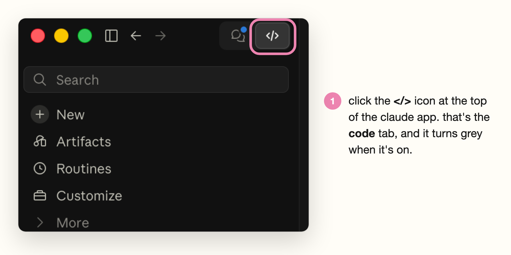
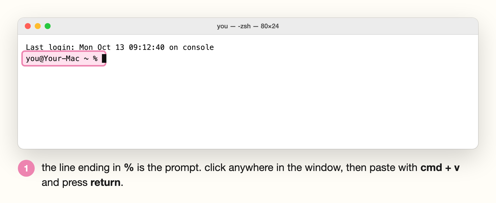
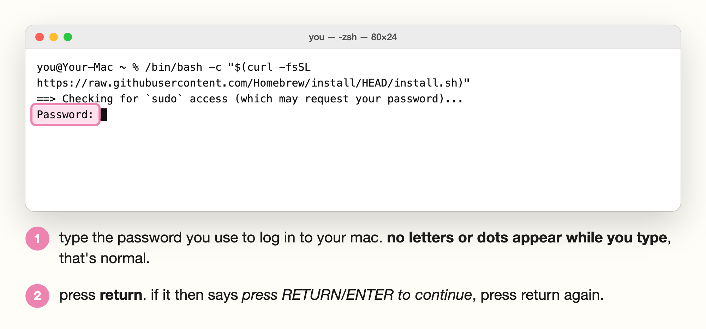
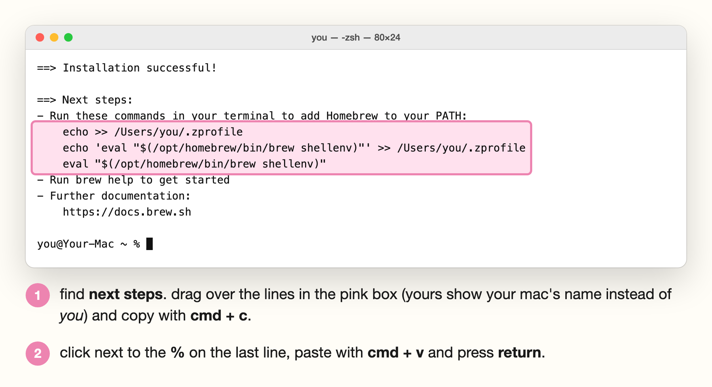
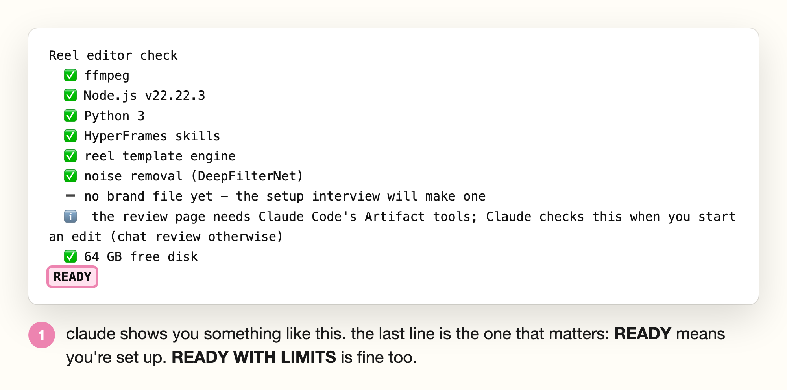

# Reel Studio

**AI reel editing for Claude Code: FavStash + Claude Reel Editor, with By Mel Ross's workflow.**

You film yourself talking to your phone. You drop the video into Claude. You get back a finished reel in your own brand: tidy audio, filler words gone, captions that land on the word, a hook title, gentle zooms, and a cover, saved right back next to your footage.

The reel editor runs on your own computer, and nothing is posted or scheduled for you. You stay the one who hits "share". A few optional extras do go online, and each one is listed under [Privacy](#privacy).

## What's inside

Two free, open-source skill sets in one folder, plus one creator's way of working:

- **Reel editor** (from [Claude Reel Editor](https://github.com/nicolapocock/claude-reel-editor) by Nicola Pocock): turns one talking-head clip into a finished reel. It asks about your brand once, lets you review the cut before anything renders, then builds the reel.
- **FavStash creator skills** (from [FavStash](https://github.com/alisadiq-ai/favstash-ai-video-editing-skills) by Ali Sadiq): find ideas, write hooks and scripts, five finished editing styles, 33 named motion effects, and planning covers and hook tests.
- **By Mel Ross's workflow**, built in:
  - Zooms are slow and gentle. They ease in and out, never a sudden punch.
  - Highlighted caption words in light sage (`#B9C8A5`), with a soft shadow so they read on light clothes.
  - **Every reel comes with a cover**: a 1080x1920 JPG from a smiling moment at the start or end, with a short topic title where Instagram's grid will show it.
  - **A phone-size copy** next to the full-quality one, small enough to text or AirDrop.
  - Finished files go **back into the folder your footage came from** (for example the iCloud Drive folder you film into), so they're on your phone when you're ready to post.
  - **Correct color from iPhone HDR clips.** An iPhone often films in HDR, and a plain conversion makes the picture lighter, greyer and cooler than the real scene. On a Mac the editor converts HDR clips with Apple's own HDR to SDR converter before it cuts, and labels every video it makes as standard color (BT.709). If it can't (not a Mac, or the conversion fails its check), it tells you the color is only approximate.
  - **A natural studio look.** Out of the box: mild denoise and sharpen only. Your colors and your real background are left alone. A gentle color grade and a background blur are there if you want them (set them to 1 in your brand file). No skin smoothing. You get a before/after frame to review.
  - **Graphics behind, in front, or both.** Big type or a shape can sit behind your head so you stand in front of it. If the cutout's edges aren't clean in a shot, that graphic is drawn as a normal overlay and you're told.
  - **One link for a reel** (added by By Mel Ross): review the cut, then touch up the finished reel on the same page. Add text, pictures and sounds, pick a theme, make pictures circle your head, search GIPHY with your own free key. If you go back and re-cut, your touch-ups come along.
  - **4 themes.** Editorial, Bold, Handwritten and Whimsical change the fonts, captions, titles and card shapes in one go. Your colors and name stay yours. Ask Claude to "show me this reel in each theme" and pick from stills.
  - **Photos that circle your head.** Hand over 1 to 6 photos and they travel round you, behind your head on one side and in front on the other. The ring is placed from your outline so it stays above your eyes. Mac only; elsewhere the photos show in front and the build says so.
  - **40 sound effects** (whoosh, pop, snap, impact, rise, ding, typing, paper, glitch and more), every one generated for this project, so there's nothing to license. Each has its own volume.
  - **A music bed that follows your voice.** It dips while you speak and comes back up in the gaps, with a simple voice / music / effects mix and a final loudness of -16 LUFS with a true peak under -2 dBTP and no clipping (the same gentle level the voice clean-up uses; -14 is one setting away for a loud, music-led reel).
  - **A gentle voice clean-up.** Noise removal at a soft setting (DeepFilterNet 20 dB), no gate, no presence boost, and a loudness of -16 LUFS. Quiet recordings sounded distorted with a heavier chain, so the default adds as little gain and as few boosts as it can.
  - **An editor page** (added by By Mel Ross): a local page, usable from a phone on your Wi-Fi, to fix caption words, drop or keep pieces of the cut, switch pills and sounds on and off, add GIF/graphic/photo popups and put text in front of or behind you, then Re-render. See `references/editor-page.md`.
  - **A clip finder** (added by By Mel Ross): hand it one long recording and it ranks the best 30-60 second moments from the transcript, you pick, and each pick becomes its own reel folder. Nothing is cut or uploaded until you say yes. See `references/find-clips.md`.
  - **A Style Menu** (added by By Mel Ross): 14 looks you can call by ID ("H3, C2, L8"): handwritten-overline hooks, caption styles, and layouts such as a tilted photo stack, an icon-tile grid, a hand-drawn check or X list, a stat card and a photo sticker with a caption. 6 more are planned; Claude won't offer those until they work. See `skills/3-editing/reel-editor/references/style-menu.md`.
  - **A home page with a framing check** (added by By Mel Ross, 0.12.0): drop in a clip before editing and see whether it was filmed in a way that works: upright, light, camera steady, room above your head, face clear of Instagram's buttons. Then pick the kind of reel and copy the request. See `skills/3-editing/reel-editor/references/home-and-framing.md`.
  - **Material kits** (added by By Mel Ross, 0.11.0): cards built from pictures of real paper, tape, labels and stickers, so a list is a taped sheet of paper and not a drawn box. Bring your own materials; the bundled kit is a marked placeholder. See `skills/3-editing/reel-editor/references/material-kits.md`.
  - **A looks page, a style card, labelled checks, and notes that become rules** (added by By Mel Ross, 0.10.0): pick looks by sight and copy the request; see the plan in 6 lines before anything renders; get a report that separates Measured, Looked at and Not checked; and a note you give twice becomes a rule for every reel. See `skills/3-editing/reel-editor/references/style-flow.md`.
  - **A storyboard before you build** (added by By Mel Ross): `scripts/storyboard.py` shows stills of two to four looks on your own reel, side by side in one image, with no video render, so you pick before anything is built.
  - **A word list for names** (added by By Mel Ross): add the names and brand words Whisper mishears to `"vocabulary"` in your brand file once, and every caption after that comes out spelled right.
  - **A smoother audio join at cuts** (added by By Mel Ross): the audio crossfades across each cut while the picture cuts at the same instant, so cuts do not click.
  - **A thumbnail studio** (from Claude Reel Editor): pick a cover frame, add a headline in your brand fonts and download 1080x1920, 1080x1440 and 1080x1080 PNGs. It runs on your Mac only. Say "open my thumbnail studio".
  - **1080x1920 by default, 4K optional.** Instagram shows 1080x1920 at most, so that is what renders unless you choose 4K in the setup (slower, and only sharper if you filmed in 4K).
  - Telemetry is off, and nothing is ever posted for you.

Not sure which skill does what? See [skills/README.md](skills/README.md). The short version: **talking-head reel = reel editor**. Setup installs it with the two planning skills (ideas and scripts). The FavStash editing styles, the motion effects and the publishing skill are extras: ask Claude to add them when you want them.

## What you need

- A Mac (that's what this is tested on; Windows and Linux are untested)
- [Claude Code](https://claude.com/claude-code) on a paid Claude plan. The desktop app's **Code** tab is Claude Code.
- Google Chrome (it's used to make the cover)
- About 10 GB of free disk space

## Install (about 20 minutes, once)

You'll paste a few commands. You don't need to understand them.

**1. Open Claude Code.** Download the Claude app from [claude.com/download](https://claude.com/download), sign in, and click the **</>** icon at the top. That's the Code tab.



**2. Open Terminal.** Press `cmd + space`, type `terminal`, press return.



**3. Install Homebrew** (a free app installer for Mac). Paste this and press return:

```bash
/bin/bash -c "$(curl -fsSL https://raw.githubusercontent.com/Homebrew/install/HEAD/install.sh)"
```

It asks for your Mac password. You won't see the letters as you type; that's normal.



When it finishes, scroll up to **Next steps**, copy the two or three lines under it from *your* Terminal, paste them and press return.



**4. Install the video tools:**

```bash
brew install ffmpeg node git yt-dlp
```

You can close Terminal now.

**5. Install Reel Studio.** Back in the Claude app, on the Code tab, paste:

```text
Set up Reel Studio from github.com/mtravagl26/reel-studio for my reels.
Follow its INSTALL_FOR_AGENTS.md: install the reel editor and the two planning
skills (no extras yet), keep telemetry off,
copy the example brand so I can make it mine, and run both doctor checks.
```

Claude may ask permission to install things. Check each request is about this setup (Reel Studio, HyperFrames, ffmpeg, node) before you say yes. You're done when the reel editor's check ends with **READY** (or **READY WITH LIMITS**, which means something optional is missing and you can still edit).



## Make a reel

1. Film yourself talking to camera on your phone, **in 1080p at 30 fps with HDR off** (see "Camera settings" below). Under two minutes is easiest.
2. Get the video onto your Mac (AirDrop, or film into a synced folder like iCloud Drive).
3. In Claude Code, type **edit this into a reel** and drag the video into the message box. Or type **open Reel Studio**: Claude gives you a page where you drop the video in, see whether it was filmed well, and pick the kind of reel.
4. **First time only:** Claude asks about your brand, one question at a time: colors, fonts, caption style, sounds, pacing, zooms and your usual call to action. A reel you wish you'd made is the most useful thing to share. About 5 minutes.
5. **Review the cut.** Claude sends you one link. It opens on step 1, Review: tap words to cut them, bring back any "um" it removed, check the captions and graphics, then tell Claude **build preview**. The same link later opens step 3, Touch-ups, for small fixes to the finished reel. No link? Claude does the same review with you in chat.
6. Watch the preview. Tell Claude what to change, with the time it happens ("at 0:12 the caption covers my face").
7. Say **final**. Claude renders the full-quality reel, picks a few smiling stills for the cover, makes the cover with a short title, and puts three files back in your footage folder:
   - `Your reel.mp4`: full quality, the one to post
   - `Your reel (phone).mp4`: a small copy for texting or a quick look
   - `Your reel cover.jpg`: the cover to pick when you post
8. Post it yourself whenever you like.

From the second reel on, your brand is saved, so it's just film, drop, review, final.

### Camera settings

Set these once on your phone:

- **1080p at 30 fps.** The reel is built at 1080 x 1920, which is also what Instagram shows, so 4K detail is thrown away. A 4K clip at 60 fps is 8 times the data and makes every step slower.
- **HDR video off.** HDR has to be converted to standard color first, and that conversion is only approximate on some computers.
- **Phone upright** (portrait).

On an iPhone: Settings > Camera > Record Video > **1080p HD at 30 fps**, and switch off **HDR Video**.

A 4K or HDR clip still works. The editor tells you when a clip is heavier than it needs to be. Film in 4K only when you want a big zoom on your face (1.5x or more).

## Your brand file

Your look lives in two files in a folder called `reels` in your home folder:

- `brand.json`: the settings the scripts read (colors, fonts, caption size and position, zoom, where finished files go)
- `brand.md`: the same in plain words, plus your rules ("no b-roll", "never outline captions")

You never have to open them. Tell Claude what to change ("make my captions one word at a time", "use pink for highlight words") and it updates them, and it adds any correction you make during an edit to your rules.

Want to start from an example? [`brand/`](brand) holds By Mel Ross's brand:

| Setting | By Mel Ross |
|---|---|
| Name | By Mel Ross |
| Main color | `#0d2b2d` deep teal |
| Highlight color | `#B9C8A5` light sage |
| Light color | `#f5f2ec` cream |
| Fonts | Lora (headlines), Inter (captions), Lora Italic (accents). Free fonts, included in `skills/3-editing/reel-editor/themes/_fonts/` |
| Captions | Short phrases, sentence case, white, sage key word with a soft teal shadow |
| Zooms | 1.04x over 2.5 s, eased in and out, about every 6 s |
| Music and sound effects | None |
| Finished files | Back into the footage folder (`"deliver_dir": "footage"`) |

[`brand/style-reference.md`](brand/style-reference.md) describes, in words, the reel this brand is tuned to. Copy `brand.example.json` to `~/reels/brand.json`, `brand.example.md` to `~/reels/brand.md` and the fonts from `skills/3-editing/reel-editor/themes/_fonts/` to `~/reels/fonts/`, then make them yours. There's a second, made-up example in [`brand/examples/`](brand/examples) that is fast and loud where this one is calm.

Useful `brand.json` settings this version adds:

- `"enhance"`: the studio look. `{"on": true, "strength": 1, "color": 1, "exposure": 1, "denoise": 1, "sharpen": 1, "background": 1, "warmth": 1}`; each amount is a multiplier (1 default, 0 off, 2 double) and `"on": false` turns it off. See [look-and-layers](skills/3-editing/reel-editor/references/look-and-layers.md).
- `"mix"`: `{"voice": 0, "music": -14, "duck": -10, "effects": 0}` in dB, with `"music"` set to a file of your own (or one made by `make_music_bed.py`). See [sound-and-mix](skills/3-editing/reel-editor/references/sound-and-mix.md).
- `"sfx_volume"`: a level change per sound effect, e.g. `{"pop": -3}`.

- `"zoom"`: `{"scale": 1.04, "seconds": 2.5, "ease": "sine.inOut", "every": 6}` is the gentle default. For quick punch-ins use `{"scale": 1.07, "seconds": 0.22, "ease": "power3.out", "every": 2.2}`.
- `"deliver_dir"`: `"footage"` sends finished files back to the folder the clip came from; or give any folder, like `"~/Movies/Reels"`.
- `"caption_accent_shadow"`: the shadow behind highlighted caption words.
- `"cover_title_y"`: how far from the top the cover title sits (default 300).

## If something goes wrong

| What you see | What to do |
|---|---|
| `command not found: brew` | Close Terminal, open it again. Still broken? Redo the Next steps lines from your own Terminal |
| `command not found: ffmpeg` or `node` | Run `brew install ffmpeg node git yt-dlp` again |
| A check line has ❌ | Paste the whole message into Claude Code and say "fix this" |
| A render fails with `uv_os_setpriority EACCES` | Ask Claude to use `render-nonice.sh` (same render, without the low-priority setting some background runs refuse) |
| The cover says no Chrome found | Install Google Chrome |
| The build says "color is only approximate" | The clip is HDR and this computer couldn't convert it (the converter is macOS only). Film in iPhone Settings > Camera > Formats > Most Compatible, or cut on a Mac |
| The edit looks off-brand | Tell Claude what's wrong. It adds it to your brand rules |

## Privacy

- Your footage and renders stay on your computer. Claude reads the transcript and a few still frames to plan the edit, as with anything you do in Claude.
- Transcription runs locally with Whisper. If you choose to add an ElevenLabs key, audio goes to ElevenLabs for tighter caption timing; without a key, nothing leaves your Mac.
- HDR to standard color uses `avconvert`, built into macOS, on your own computer.
- The speaker cutout uses Apple's built-in person segmentation (macOS) on your own computer; the sound effects and the optional music bed are generated on your computer. Nothing is downloaded for them.
- HyperFrames telemetry is switched off (`HYPERFRAMES_NO_TELEMETRY=1`, `DO_NOT_TRACK=1`).
- Nothing is connected to your social accounts, and setup does not install the publishing skill.
- **What goes online, and only if you ask for it:**
  - An ElevenLabs key (optional) sends your audio to ElevenLabs for caption timing.
  - A GIPHY key (optional) turns on GIF search on the touch-ups page. Your search words go to GIPHY, and the GIF you tap is downloaded to your Mac.
  - Giving Claude a link to someone's reel downloads that video to your computer with `yt-dlp` so it can be studied.
  - The planning skills can read your saved posts and results from FavStash if you connect a FavStash account. Without one they work from links and transcripts you give them.
  - The `publish-and-analyze` extra sends a finished reel to FavStash to schedule it. You connect it yourself and approve each post.

## For developers

```bash
npm test            # FavStash helper tests
npm run validate    # skills, links, sound checksums, private-file exclusions
npm run doctor -- --workspace <your workspace> --strict   # FavStash tools
npm run doctor:reel # reel editor tools
```

The reel editor's own tests (`tests/reel-*.test.mjs`) cover the sound library, the mix (loudness, true peak, music ducking), the studio look and the layered graphics; they use ffmpeg and skip what the machine can't run.

The agent contract is [AGENTS.md](AGENTS.md); setup for agents is [INSTALL_FOR_AGENTS.md](INSTALL_FOR_AGENTS.md).

## Credits and license

- **FavStash creator skills** by Ali Sadiq / [FavStash](https://www.favstash.app): [github.com/alisadiq-ai/favstash-ai-video-editing-skills](https://github.com/alisadiq-ai/favstash-ai-video-editing-skills), Apache-2.0.
- **Claude Reel Editor** by Nicola Pocock ([@getgitgirl](https://instagram.com/getgitgirl)): [github.com/nicolapocock/claude-reel-editor](https://github.com/nicolapocock/claude-reel-editor), MIT. Its license stays with the skill in [skills/3-editing/reel-editor/LICENSE](skills/3-editing/reel-editor/LICENSE).
- **Lora** (The Lora Project Authors) and **Inter** (The Inter Project Authors), SIL Open Font License 1.1.
- **HyperFrames** by HeyGen renders the video; it's installed during setup, not included here.
- Combined and adapted by **By Mel Ross**. What changed is listed in [NOTICE](NOTICE). This project isn't affiliated with or endorsed by FavStash, Nicola Pocock or HeyGen.

Reel Studio is released under the [Apache License 2.0](LICENSE). The reel editor parts are also under their original [MIT license](skills/3-editing/reel-editor/LICENSE).
