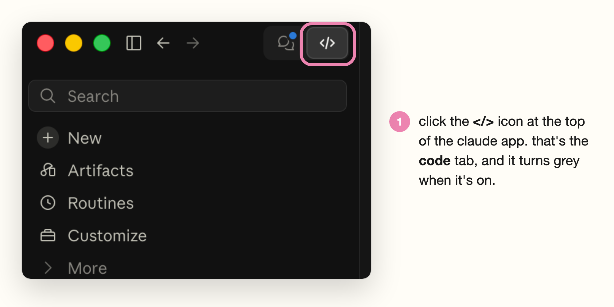

# Reel Studio

**AI reel editing for Claude Code: FavStash + Claude Reel Editor, with By Mel Ross's workflow.**

You film yourself talking to your phone. You drop the video into Claude. You get back a finished reel in your own brand: tidy audio, filler words gone, captions that land on the word, a hook title, gentle zooms, and a cover, saved right back next to your footage.

Everything happens on your own computer. Nothing gets posted, uploaded or scheduled for you. You stay the one who hits "share".

## What's inside

Two free, open-source skill sets in one folder, plus one creator's way of working:

- **Reel editor** (from [Claude Reel Editor](https://github.com/nicolapocock/claude-reel-editor) by Nicola Pocock): turns one talking-head clip into a finished reel. It asks about your brand once, lets you review the cut before anything renders, then builds the reel.
- **FavStash creator skills** (from [FavStash](https://github.com/alisadiq-ai/favstash-ai-video-editing-skills) by Ali Sadiq): find ideas, write hooks and scripts, five finished editing styles, 33 named motion effects, and planning covers and hook tests.
- **By Mel Ross's workflow**, built in:
  - Zooms are slow and gentle. They ease in and out, never a sudden punch.
  - Highlighted caption words in light sage (`#B9C8A5`), with a soft shadow so they read on light clothes.
  - **Every reel comes with a cover**: a 1080x1920 JPG from a smiling moment at the start or end, with a short topic title where Instagram's grid will show it.
  - **A phone-size copy** next to the full-quality one, small enough to text or AirDrop.
  - Finished files go **back into the folder your footage came from** (for example the iCloud Drive folder you film into), so they're on your phone when you're ready to post.
  - Telemetry is off, and nothing is ever posted for you.

Not sure which skill does what? See [skills/README.md](skills/README.md). The short version: **talking-head reel = reel editor**. Effects, styles, scripts and ideas = the FavStash skills.

## What you need

- A Mac (that's what this is tested on; Windows and Linux are untested)
- [Claude Code](https://claude.com/claude-code) on a paid Claude plan. The desktop app's **Code** tab is Claude Code.
- Google Chrome (it's used to make the cover)
- About 10 GB of free disk space

## Install (about 20 minutes, once)

You'll paste a few commands. You don't need to understand them.

**1. Open Claude Code.** Download the Claude app from [claude.com/download](https://claude.com/download), sign in, and click the **</>** icon at the top. That's the Code tab.



**2. Open Terminal.** Press `cmd + space`, type `terminal`, press return.


**3. Install Homebrew** (a free app installer for Mac). Paste this and press return:

```bash
/bin/bash -c "$(curl -fsSL https://raw.githubusercontent.com/Homebrew/install/HEAD/install.sh)"
```

It asks for your Mac password. You won't see the letters as you type; that's normal.


When it finishes, scroll up to **Next steps**, copy the two or three lines under it from *your* Terminal, paste them and press return.


**4. Install the video tools:**

```bash
brew install ffmpeg node git
```

You can close Terminal now.

**5. Install Reel Studio.** Back in the Claude app, on the Code tab, paste:

```text
Set up Reel Studio from github.com/mtravagl26/reel-studio for my reels.
Follow its INSTALL_FOR_AGENTS.md: install all eleven skills, keep telemetry off,
copy the example brand so I can make it mine, and run both doctor checks.
```

Claude may ask permission to install things. Check each request is about this setup (Reel Studio, HyperFrames, ffmpeg, node) before you say yes. You're done when the reel editor's check ends with **READY** (or **READY WITH LIMITS**, which means something optional is missing and you can still edit).


## Make a reel

1. Film yourself talking to camera on your phone. Under two minutes is easiest.
2. Get the video onto your Mac (AirDrop, or film into a synced folder like iCloud Drive).
3. In Claude Code, type **edit this into a reel** and drag the video into the message box.
4. **First time only:** Claude asks about your brand, one question at a time: colours, fonts, caption style, sounds, pacing, zooms and your usual call to action. A reel you wish you'd made is the most useful thing to share. About 5 minutes.
5. **Review the cut.** Claude sends you a review page. Tap words to cut them, bring back any "um" it removed, check the captions and graphics, then tell Claude **build preview**. No review page? Claude does the same review with you in chat.
6. Watch the preview. Tell Claude what to change, with the time it happens ("at 0:12 the caption covers my face").
7. Say **final**. Claude renders the full-quality reel, picks a few smiling stills for the cover, makes the cover with a short title, and puts three files back in your footage folder:
   - `Your reel.mp4`: full quality, the one to post
   - `Your reel (phone).mp4`: a small copy for texting or a quick look
   - `Your reel cover.jpg`: the cover to pick when you post
8. Post it yourself whenever you like.

From the second reel on, your brand is saved, so it's just film, drop, review, final.

## Your brand file

Your look lives in two files in a folder called `reels` in your home folder:

- `brand.json`: the settings the scripts read (colours, fonts, caption size and position, zoom, where finished files go)
- `brand.md`: the same in plain words, plus your rules ("no b-roll", "never outline captions")

You never have to open them. Tell Claude what to change ("make my captions one word at a time", "use pink for highlight words") and it updates them, and it adds any correction you make during an edit to your rules.

Want to start from an example? [`brand/`](brand) holds By Mel Ross's brand:

| Setting | By Mel Ross |
|---|---|
| Name | By Mel Ross |
| Main colour | `#0d2b2d` deep teal |
| Highlight colour | `#B9C8A5` light sage |
| Light colour | `#f5f2ec` cream |
| Fonts | Lora (headlines), Inter (captions), Lora Italic (accents). Free fonts, included in `brand/fonts/` |
| Captions | Short phrases, sentence case, white, sage key word with a soft teal shadow |
| Zooms | 1.04x over 2.5 s, eased in and out, about every 6 s |
| Music and sound effects | None |
| Finished files | Back into the footage folder (`"deliver_dir": "footage"`) |

[`brand/style-reference.md`](brand/style-reference.md) describes, in words, the reel this brand is tuned to. Copy `brand.example.json` to `~/reels/brand.json`, `brand.example.md` to `~/reels/brand.md` and the fonts to `~/reels/fonts/`, then make them yours. There's a second, very different example in [`brand/examples/`](brand/examples).

Useful `brand.json` settings this version adds:

- `"zoom"`: `{"scale": 1.04, "seconds": 2.5, "ease": "sine.inOut", "every": 6}` is the gentle default. For quick punch-ins use `{"scale": 1.07, "seconds": 0.22, "ease": "power3.out", "every": 2.2}`.
- `"deliver_dir"`: `"footage"` sends finished files back to the folder the clip came from; or give any folder, like `"~/Movies/Reels"`.
- `"caption_accent_shadow"`: the shadow behind highlighted caption words.
- `"cover_title_y"`: how far from the top the cover title sits (default 300).

## If something goes wrong

| What you see | What to do |
|---|---|
| `command not found: brew` | Close Terminal, open it again. Still broken? Redo the Next steps lines from your own Terminal |
| `command not found: ffmpeg` or `node` | Run `brew install ffmpeg node` again |
| A check line has ❌ | Paste the whole message into Claude Code and say "fix this" |
| A render fails with `uv_os_setpriority EACCES` | Ask Claude to use `render-nonice.sh` (same render, without the low-priority setting some background runs refuse) |
| The cover says no Chrome found | Install Google Chrome |
| The edit looks off-brand | Tell Claude what's wrong. It adds it to your brand rules |

## Privacy

- Your footage, transcripts and renders stay on your computer.
- Transcription runs locally with Whisper. If you choose to add an ElevenLabs key, audio goes to ElevenLabs for tighter caption timing; without a key, nothing leaves your Mac.
- HyperFrames telemetry is switched off (`HYPERFRAMES_NO_TELEMETRY=1`, `DO_NOT_TRACK=1`).
- Nothing is connected to your social accounts. The FavStash posting service isn't set up by this pack; if you connect it yourself, it still needs your approval for each post.

## For developers

```bash
npm test            # FavStash helper tests
npm run validate    # skills, links, sound checksums, private-file exclusions
npm run doctor -- --workspace <your workspace> --strict   # FavStash tools
npm run doctor:reel # reel editor tools
```

The agent contract is [AGENTS.md](AGENTS.md); setup for agents is [INSTALL_FOR_AGENTS.md](INSTALL_FOR_AGENTS.md).

## Credits and license

- **FavStash creator skills** by Ali Sadiq / [FavStash](https://www.favstash.app): [github.com/alisadiq-ai/favstash-ai-video-editing-skills](https://github.com/alisadiq-ai/favstash-ai-video-editing-skills), Apache-2.0.
- **Claude Reel Editor** by Nicola Pocock ([@getgitgirl](https://instagram.com/getgitgirl)): [github.com/nicolapocock/claude-reel-editor](https://github.com/nicolapocock/claude-reel-editor), MIT. Its license stays with the skill in [skills/3-editing/reel-editor/LICENSE](skills/3-editing/reel-editor/LICENSE).
- **Lora** (The Lora Project Authors) and **Inter** (The Inter Project Authors), SIL Open Font License 1.1.
- **HyperFrames** by HeyGen renders the video; it's installed during setup, not included here.
- Combined and adapted by **By Mel Ross**. What changed is listed in [NOTICE](NOTICE). This project isn't affiliated with or endorsed by FavStash, Nicola Pocock or HeyGen.

Reel Studio is released under the [Apache License 2.0](LICENSE). The reel editor parts are also under their original [MIT license](skills/3-editing/reel-editor/LICENSE).
